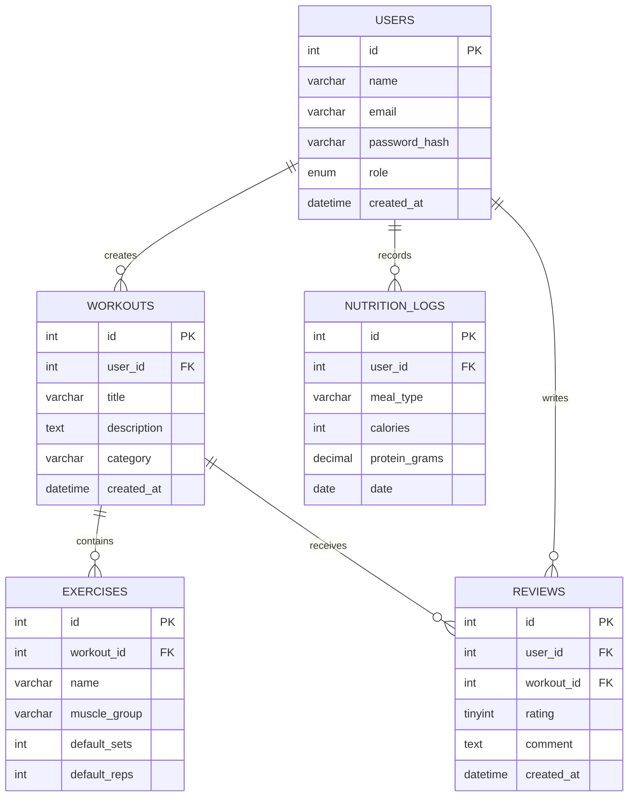

# FitPulse Entity-Relationship Diagram

This document describes the planned relational database for FitPulse. The
entity definitions and foreign keys are based on the schema concept in
[`project_brief_document.md`](./project_brief_document.md).

## Entity relationship diagram

## Entities

### `users`

Stores registered accounts and their access role.

| Column | Key | Description |
| --- | --- | --- |
| `id` | PK | Unique user identifier. |
| `name` |  | User's display name. |
| `email` |  | User's login email; it should be unique. |
| `password_hash` |  | Securely hashed password. Plain-text passwords must not be stored. |
| `role` |  | Authorization role: `admin` or `user`. |
| `created_at` |  | Account creation timestamp. |

### `workouts`

Stores workout plans or templates. Each workout is associated with the user
who created it through `user_id`.

| Column | Key | Description |
| --- | --- | --- |
| `id` | PK | Unique workout identifier. |
| `user_id` | FK → `users.id` | Owner or creator of the workout. |
| `title` |  | Workout name. |
| `description` |  | Optional explanation of the workout. |
| `category` |  | Workout category, such as Strength or Cardio. |
| `created_at` |  | Workout creation timestamp. |

### `exercises`

Stores exercise entries assigned to a workout through `workout_id`.

| Column | Key | Description |
| --- | --- | --- |
| `id` | PK | Unique exercise identifier. |
| `workout_id` | FK → `workouts.id` | Workout containing the exercise. |
| `name` |  | Exercise name. |
| `muscle_group` |  | Main muscle group targeted. |
| `default_sets` |  | Suggested number of sets. |
| `default_reps` |  | Suggested number of repetitions. |

### `nutrition_logs`

Stores a user's meal and nutrition records for a specific day.

| Column | Key | Description |
| --- | --- | --- |
| `id` | PK | Unique nutrition-log identifier. |
| `user_id` | FK → `users.id` | User who recorded the meal. |
| `meal_type` |  | Meal category, such as breakfast, lunch, or dinner. |
| `calories` |  | Calories recorded for the meal. |
| `protein_grams` |  | Protein amount recorded for the meal. |
| `date` |  | Date on which the meal was consumed. |

### `reviews`

Stores feedback that a user leaves for a workout.

| Column | Key | Description |
| --- | --- | --- |
| `id` | PK | Unique review identifier. |
| `user_id` | FK → `users.id` | User who wrote the review. |
| `workout_id` | FK → `workouts.id` | Workout being reviewed. |
| `rating` |  | Numeric rating from 1 to 5. |
| `comment` |  | Optional written feedback. |
| `created_at` |  | Review creation timestamp. |

## Relationships and cardinality

- **Users → Workouts:** One user can create zero or many workouts. Each
  workout belongs to exactly one user (`workouts.user_id`).
- **Users → Nutrition logs:** One user can record zero or many nutrition logs.
  Each log belongs to exactly one user (`nutrition_logs.user_id`).
- **Users → Reviews:** One user can write zero or many reviews. Each review
  belongs to exactly one user (`reviews.user_id`).
- **Workouts → Exercises:** One workout can contain zero or many exercises.
  Each exercise entry belongs to exactly one workout (`exercises.workout_id`).
- **Workouts → Reviews:** One workout can receive zero or many reviews. Each
  review targets exactly one workout (`reviews.workout_id`).

## Integrity rules

1. Every foreign-key value must reference an existing parent row.
2. `users.email` should be unique.
3. `users.role` should be restricted to `admin` and `user`.
4. `reviews.rating` should be restricted to integer values from 1 through 5.
5. Deleting a user or workout must define a deliberate policy for dependent
   rows, such as restricted deletion or an explicit cascade.

## Scope assumption

The current brief models `exercises` as workout-specific rows because each
exercise has a required `workout_id`. If the application later needs a shared
exercise library reused by multiple workouts, the schema should be extended
with a separate exercise-definition entity and a workout-to-exercise junction
table. That change is not part of this documented schema.
